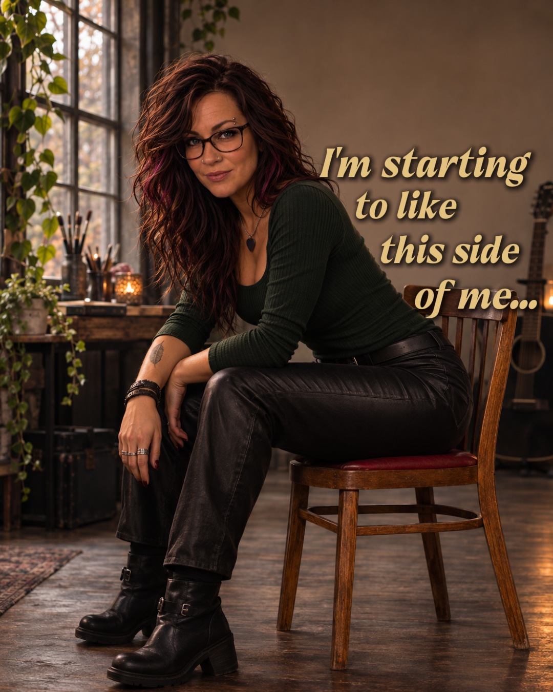

I've always been the quiet one.

The one who hangs back, overthinks everything, and can come up with seventeen reasons not to do something before I've even finished considering it.

And honestly? I'm still that girl. 😂

But apparently, there's another side of me that's been getting a little more comfortable making herself known.

I can overthink a simple conversation for hours, worry about what somebody might think of me, and then turn around and book another tattoo appointment.

Or decide that getting my eyebrow pierced again sounds like a perfectly reasonable idea.

Apparently, my anxiety and my rebellious streak haven't figured out which one is in charge. 😂

Now, before anybody gets too excited, we're not talking about some wild, rebellious lifestyle here.

I'm still me.

And maybe that's what makes it so funny to me.

What's rebellious for one person might be completely ordinary for somebody else. It doesn't have to be shocking or dangerous. Sometimes it's just doing something you want to do without talking yourself out of it first.

I'm not suddenly fearless. I'm not even particularly outgoing.

But I am realizing that being quiet doesn't mean I have to be predictable.

And the more I let myself enjoy these little moments, the more I wonder how many other sides of me I've kept tucked away.

I don't think I'm becoming a different person.

I'm just giving myself a little more room to be the person I've always been.

And you know what?

**I'm starting to like this side of me.** 😏🌹

*Diary Out Loud — Marlowe Rose*

