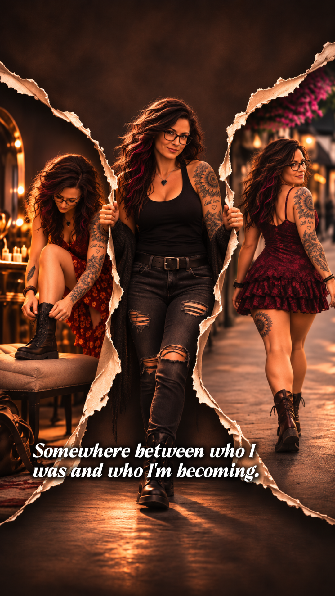

There was a time when I felt stuck.

Not necessarily unhappy with everything in my life. Just unhappy with parts of myself. Feeling like I wanted more, wanted to do more, wanted to *be* more, but not really knowing how to get there.

I had all these things I wanted to do. Things I wanted to change. Experiences I wanted to have.

But somehow, they always ended up in the same place.

*Someday.*

Someday I'll try that. Someday I'll be brave enough. Someday, when I'm more confident, when things are different, when I'm finally ready.

And for a long time, I was really good at waiting for someday.

Then came my Day One.

It wasn't some magical moment where I suddenly became confident or fearless. It was a decision to start showing up for myself, even when I didn't feel like it. Even when it was hard. Even when I couldn't see the progress I was making.

And I kept showing up.

Little by little, things started changing. Not just on the outside, but in how I saw myself.

I started realizing that maybe I didn't have to wait until I was a different version of myself to start doing the things I wanted.

Maybe I could just start.

And somewhere along the way, something else started happening.

I started saying yes to things I'd always wanted to try. Pushing past my comfort zones. Making choices simply because they made me happy, without feeling like I needed a better reason.

A little more ink. A little more confidence. A little less worrying about what everybody else might think.

I'm still an overthinker. I still get anxious. I still have days when I struggle to see what other people might see in me.

But I'm starting to like myself a little more.

And maybe part of that is because I'm finally allowing myself to live a little more.

I think that's how *One Day… or Day One?* and *Little Rebellious* ended up becoming two parts of the same story.

One is about deciding to stop putting your life on hold.

The other is about discovering how good it feels to start doing the things you've always wanted to do.

I'm still figuring things out. Still learning. Still growing.

Still a work in progress.

But I'm not waiting for someday anymore.

🌹

